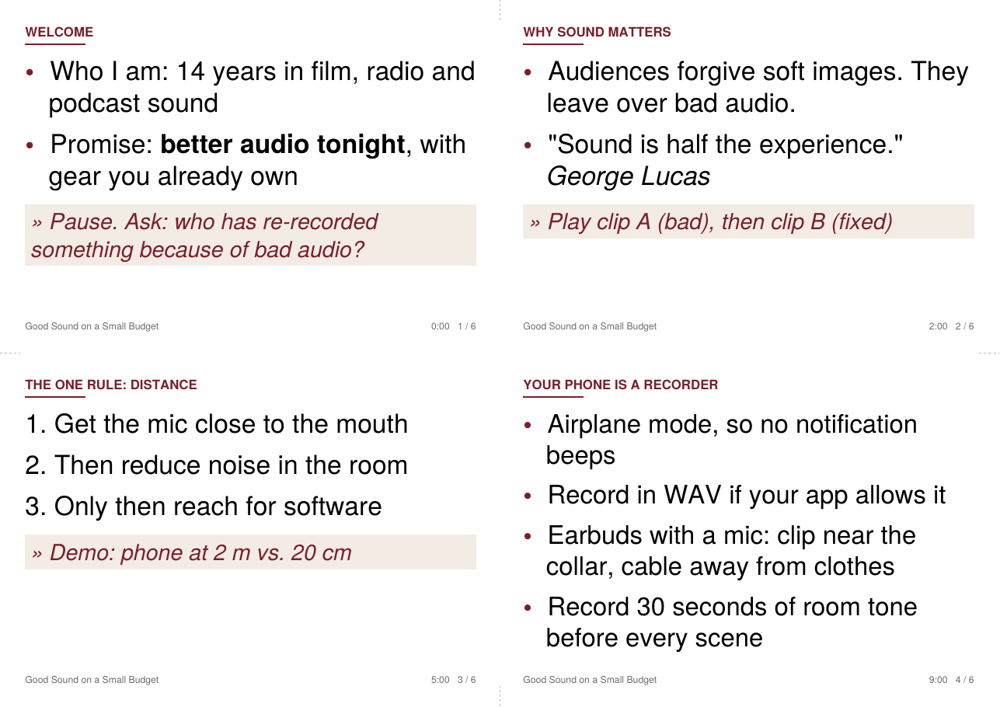

# presenter-cards

**Write your talk notes in Markdown. Print clean, readable cue cards.**

Each `#` heading becomes an A6 card (a quarter of an A4 sheet). Text is automatically sized as large as it can be while still fitting, so you can read it at a glance from a lectern. Stage cues and timings get their own styling, so you don't miss them mid-talk.

I made this for my workshops and talks on audio. I wanted to edit notes as plain text and reprint in seconds, not fight a word processor.



## Write

```markdown
---
title: Good Sound on a Small Budget
---

# The one rule: distance
@ 5:00
1. Get the mic close to the mouth
2. Then reduce noise in the room
3. Only then reach for software
> Demo: phone at 2 m vs. 20 cm
```

| Syntax | Becomes |
| --- | --- |
| `# Heading` or `## Heading` | Starts a new card (shown as a small label) |
| `- item` / `1. item` | Bullet or numbered point |
| `> text` | Stage cue, highlighted (click, pause, play clip) |
| `@ 5:00` | Time mark, shown in the footer |
| `**bold**`, `*italic*` | Emphasis |
| `title:` in front matter | Talk title in each card's footer |

## Run

```bash
pip install -e .
presenter-cards talk.md                    # one card per page (A6), talk.pdf
presenter-cards talk.md --layout a4        # four cards per A4 sheet, with cut marks
presenter-cards talk.md --max-size 26      # bigger text where it fits
```

- **A6 layout:** print on A6 card stock, or on any paper with "fit to page".
- **A4 layout:** print at 100% (no scaling), then make one cut each way at the marks.

If a card has too much text even at the minimum size (11 pt by default), the tool names the card and exits with code 1. Split the card or trim the text.

## Tests

```bash
pip install -e ".[dev]"
python -m pytest
```

## License

MIT
